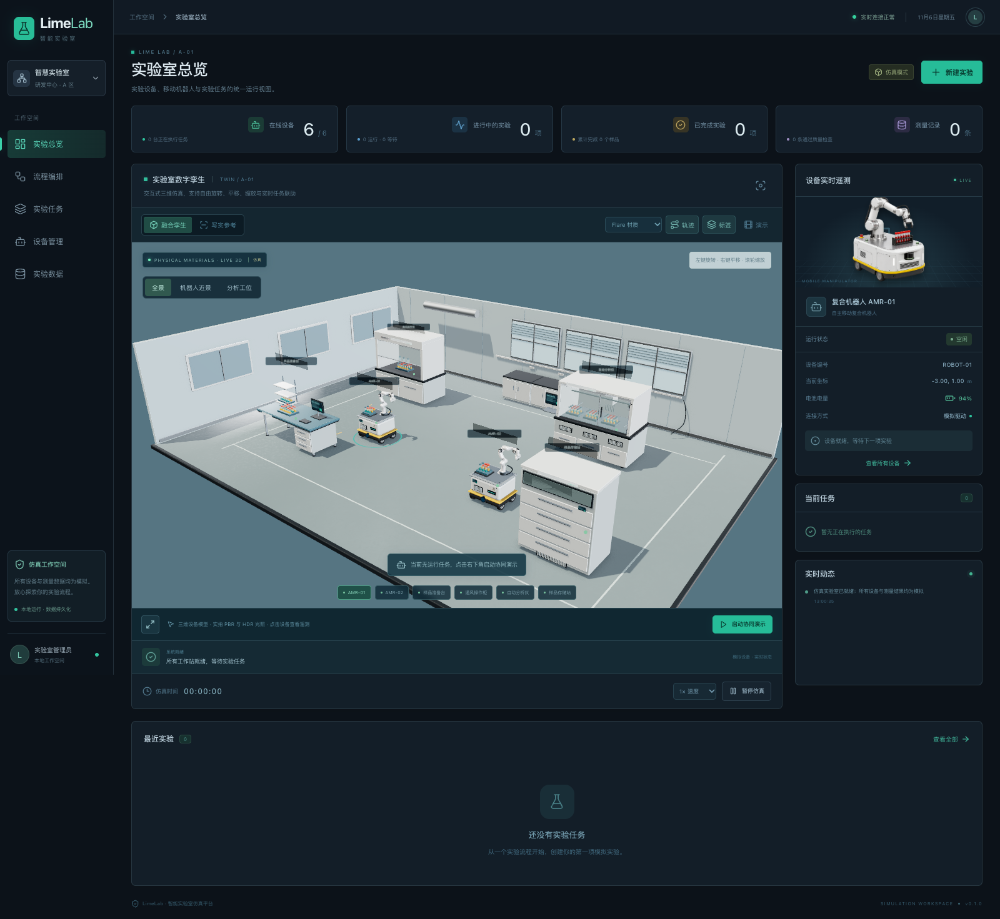
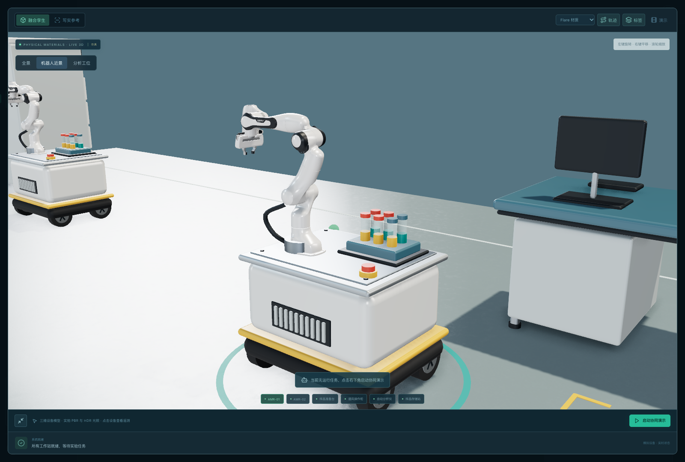

# LimeLab · 智能实验室

以参考图中的复合移动机器人实验室为主题，实现控制台、可旋转的三维场景、实验流程编辑与任务执行。默认场景使用可动机械臂 GLB、三维仪器结构、实拍地面 PBR 材质与 HDR 光照，另保留 Flare / Sunburst 图片参考与 GIF 演示。设备、运动和检测结果均为仿真。





当前为参考设计，尚未取得对应现场的完整 CAD 或多角度采集，不能当作原图实物的精确重建。第二版的模型、实际照片材质来源和许可见[三维升级说明](docs/design/physical-v2.md)，进一步的现场重建路线见[真实性分析](docs/design/photorealism.md)。

线上地址：<https://smart-lab.limeai.run>。Cloudflare 版本包含 API、实时推送、任务时钟与持久化，每个浏览器拥有独立仿真会话，见[部署说明](docs/deployment.md)。

## 快速开始

需要 Node.js 22.12 或更高版本。

```bash
git clone git@github.com:limecloud/smart-lab.git
cd "smart-lab"
npm ci
npm run dev
```

打开 <http://127.0.0.1:5174>。前端开发服务使用 5174 端口，后端使用 4311，`/api` 请求由 Vite 代理到后端。服务默认仅监听本机。

构建并运行单服务版本：

```bash
npm run build
npm start
```

打开 <http://127.0.0.1:4311>。后端同时提供构建后的网页和 API。可以用进程环境变量 `PORT` 修改后端端口，用 `LAB_DATA_PATH` 指定状态文件位置。

## 使用流程

1. 在“实验总览”的默认“融合孪生”中，拖动旋转、右键平移、滚轮缩放、点击设备。切换 Flare / Sunburst 材质和轨迹图层，点击“启动协同演示”创建真实模拟任务；“写实参考”为固定视角图片，GIF 可预览和下载。
   “机器人近景”和“分析工位”可近距离检查三维结构，左下角按钮放大工作区，Escape 退出。
2. 在“流程编排”选择模板，配置步骤、目标设备、接驳站和仿真时长，保存流程。
3. 新建实验任务，选择流程、样品数和优先级。调度器按设备可用性推进步骤。
4. 在“实验任务”查看步骤与日志，暂停、继续、取消任务；故障修复后可重试失败任务。
5. 在“实验数据”查看带任务和样品关联的模拟结果，导出 CSV。

全局暂停和速度控制作用于仿真时钟。任务暂停只作用于该任务。设备离线或故障、资源冲突和非法操作由后端检查，界面显示返回的原因。

## 实现结构

```text
src/                    React 控制台与 Three.js 场景
server/                 HTTP / SSE 服务、调度器与持久化
edge/                   Cloudflare Worker 与独立会话 Durable Object
shared/types.ts         前后端共享数据模型
tests/                  调度器与 API 验证
e2e/                    浏览器操作验证
docs/api.md             API 合同与场景坐标
docs/architecture.md    分层原理、状态机与真机替换边界
docs/research/          一手来源、实现分析与未核验问题
docs/evidence/          本项目的运行与 REA 验证记录
data/                   本地仿真状态，自动创建且不进入版本库
```

React 展示后端状态并提交操作；Three.js 通过同一状态更新机器人位置。调度器管理任务状态、仿真时钟和设备资源，HTTP API 与 SSE 共用这一状态源。图像素材随项目分发，运行时不依赖外部模型或 API key。

本地 Node 服务使用原子 JSON 文件保存状态；Cloudflare 使用 SQLite Durable Object 和 alarm 复用同一个调度器，部署不依赖本机在线。

写实素材已保存在项目中，运行时不调用图像生成服务。[视觉设计与素材说明](docs/design/README.md) 记录两种模型的提示词、配准方式、透明素材和动画来源。

## 验证

```bash
npm run typecheck
npm test
npm run build
npm run test:e2e
```

浏览器测试使用独立状态文件及 4312 / 5175 端口，不占用 4311 预览服务。测试默认使用本机 Chrome；可通过 `PLAYWRIGHT_EXECUTABLE_PATH` 指向已有 Chromium。如果本机没有可用浏览器，请按 Playwright 的官方说明安装浏览器后再运行。实际检查结果与覆盖范围见 [验证记录](docs/evidence/validation.md)。

## 研究与复刻边界

- [研究入口](docs/research/README.md)：公开资料如何支持移动操作、仪器互联和实验闭环。
- [架构设计](docs/architecture.md)：参考设计与本项目实现的对应关系。
- [API 合同](docs/api.md)：可用接口、数据类型与错误语义。
- [REA 记录](docs/evidence/rea.md)：分析对象、Evidence 与证据局限。

原图能证明其可见布局与宣传标签，不能证明导航算法、定位精度、仪器协议或 AI 模型的真实实现。当前未取得 HintonAI 原厂安装包、网页产物或设备接口，因此不声称恢复其源代码。项目按照公开工程路线独立实现；真机落地还需要现场地图、末端工具、运动规划、接驳标定、设备协议和硬件安全系统。
