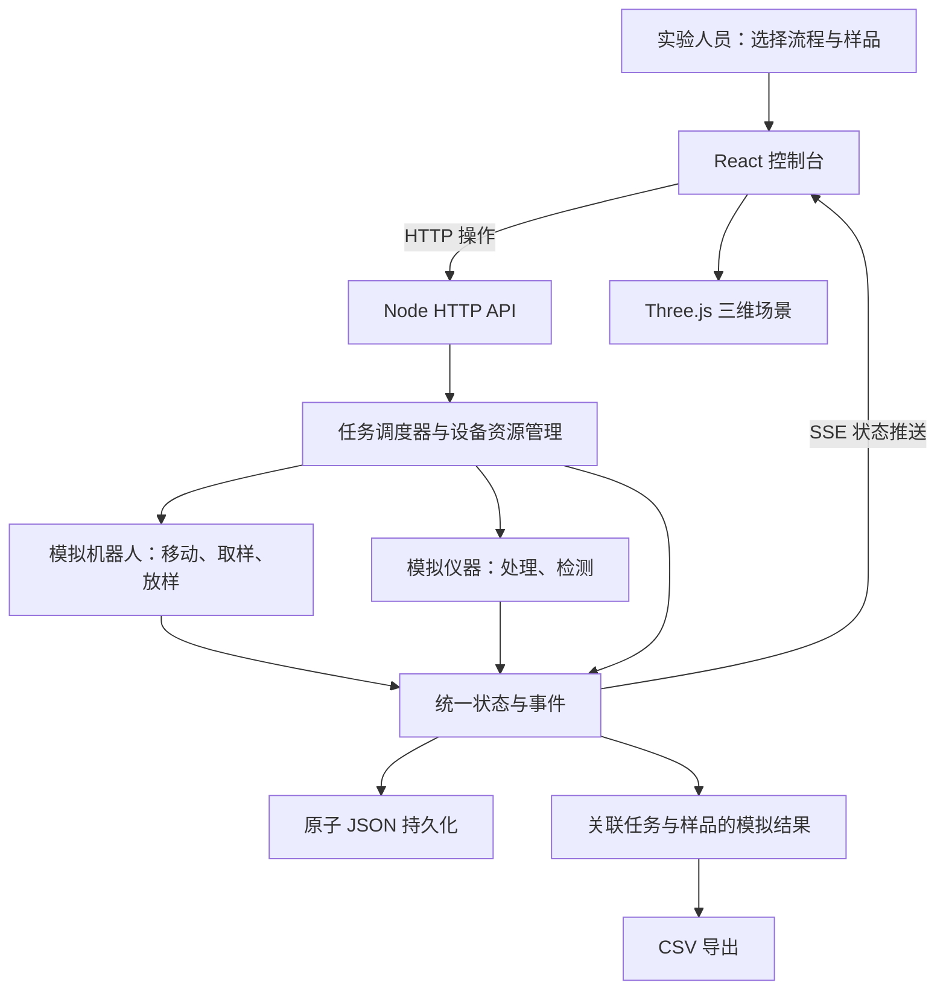
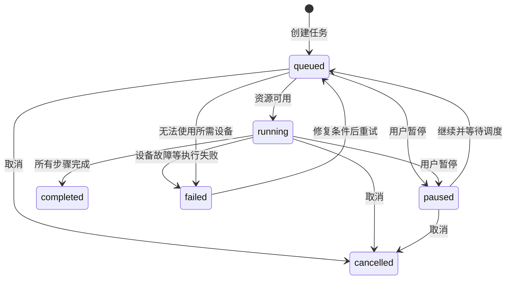

# 智能实验室实现原理与本项目架构

本页解释由任务编排、复合机器人和仪器协作组成的实验系统，并标明当前项目的仿真边界。相关一手资料与事实限制见 [研究入口](research/README.md)。下图是本项目的参考设计，不代表 HintonAI 内部架构。

## 分层与数据流

查看架构图源码

界面、三维场景和任务列表读取同一个后端状态，避免动画与任务执行各自运行。用户提交的是流程和任务；调度器在每次推进前检查当前步骤依赖的设备，再开始执行。每个任务保存流程步骤快照，后续修改模板不会改变正在运行的实验。

上图展示本地 Node 版本。Cloudflare 版本将 HTTP 层替换为 Worker，将状态文件替换为每浏览器独立的 SQLite Durable Object，用 alarm 驱动同一个 `LabEngine`，SSE 和 API 合同保持一致。对象唤醒自动继续仿真，本地进程重启仍默认暂停任务，详见[部署说明](deployment.md)。

默认“融合孪生”使用可动机械臂 GLB、原创三维底盘与仪器内腔、实拍 PBR 地面和 HDR 环境光照，保留旋转、平移、缩放、设备选择和任务关节动画。屏幕空间环境遮蔽补充接触处的明暗，窄屏关闭该效果。可选“写实参考”将 AI 生成的固定实验室图片作为背景，按后端坐标投影透明机器人。两者消费同一个状态源；另附 GIF 是离线演示。该场景仍是参考设计，不能当作对应现场的精确重建；来源、许可与实现见[第二版三维说明](design/physical-v2.md)。

## 从样品到检测结果

1. 用户指定实验流程、样品数和优先级，后端校验动作、设备能力、目标站与时间参数。
2. 调度器选择可执行任务，检查机器人和仪器可用性，获取步骤需要的资源。冲突任务等待资源释放。
3. 机器人执行移动步骤，三维底盘位置随仿真时间变化；取放步骤表现为机械臂操作阶段。
4. 仪器执行处理和测量步骤。测量产生关联 `taskId`、`sampleId`、指标、单位、质量标记和时间的结果。
5. 每个状态变化生成事件并推送到控制台，结果可查询和导出。

本项目的位置由插值计算，检测值由可重复的模拟规则生成。路径与机械臂动画用于展示调度结果，不能支持避障精度、碰撞检测或移液精度的结论。

## 任务状态与失败处理

查看任务状态图源码

具体允许的状态转换以 API 与调度器实现为准。暂停、取消、结束和失败应释放步骤资源；恢复执行需要重新检查可用性。取放动作中途暂停后，如果机器人被其他任务调走，恢复时会显式插入重新接驳的移动步骤，再继续取放。运行中的设备不能通过普通状态修改直接切离线。进程重启后未完成任务恢复为暂停，避免自动重复执行。

## 设备接口与真机替换

| 本项目 | 真机系统需要替换或补充的内容 |
| --- | --- |
| 仿真设备与能力列表 | 实际型号、协议、连接管理、能力发现和版本 |
| 机器人直线位置插值 | 地图、定位、导航、障碍物与交通协调 |
| 机械臂步骤和动画 | 工具标定、抓取位姿、运动规划、力控与操作反馈 |
| 仪器处理倒计时 | SiLA、OPC UA、厂商 SDK 或仪器控制协议 |
| 模拟检测数值 | 实际数据采集、单位与校准、质量控制和结果文件 |
| JSON 原子状态文件 | 生产数据库、审计、权限、备份和并发事务 |
| 页面中的操作反馈 | 独立于网页的硬件安全系统与现场联锁 |

SiLA 解决实验设备服务与数据交互的一类问题，ROS 2 / Nav2、MoveIt 和 Open-RMF 分别覆盖机器人通信、导航、机械臂规划和多机器人协调的不同层次。是否采用这些组件，需要结合已有机器人控制器与仪器接口决定。当前没有这些协议的实际接入，不因保留同类数据结构就声称支持真机。

AI 可以在实验方案建议、自然语言转流程和结果分析环节提供候选方案。可执行流程仍需要设备能力校验与执行约束。当前版本不调用 AI 服务，也不宣称实现原图中的“AI 垂类模型赋能”或自动实验优化。

## 实现取舍

前后端共享 TypeScript 类型，减少重复数据模型。后端使用 Node 内置 HTTP、事件与文件能力；前端使用 React 和 Three.js。以固定设备和五类动作覆盖明确需求，暂不引入消息队列、分布式服务或插件框架。新增真机驱动前，应先明确命令确认、超时、幂等、结果回执和恢复语义。
